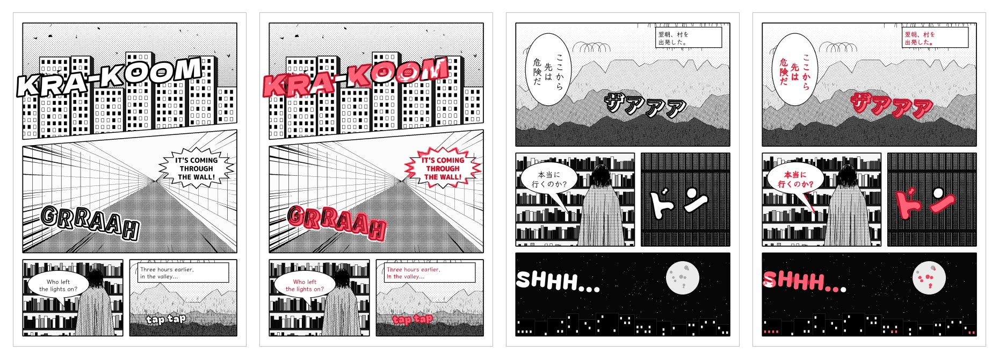
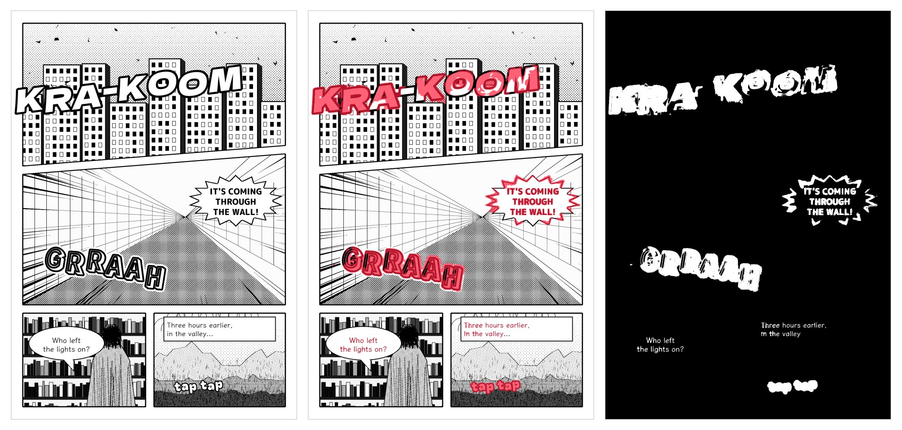
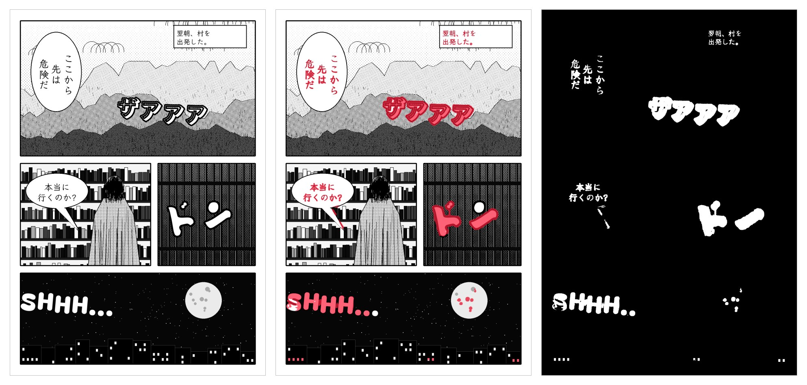
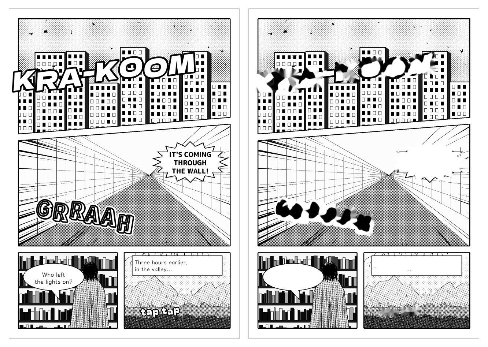
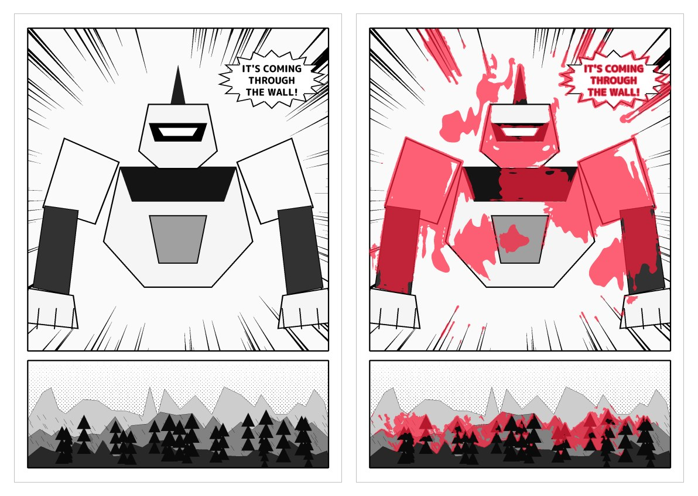

<div align="center">

# Manga Text Mask

**Find the text and sound effects on a manga page, and get them back as a mask.**

One ONNX file. Runs locally. No account, no upload.

[Quick start](#quick-start) · [Examples](#examples) · [Speed](#speed-and-memory) · [Quality and limits](#quality-and-limits) · [Guide](docs/GUIDE.md)

<br>



</div>

<br>

The mask is built for cleaning: feed it to an inpainting tool to paint over the letters. It marks speech balloons, narration boxes, and sound effects drawn over the art, in Latin and Japanese script.

- **Same size as your page.** Any resolution goes in, and the mask comes back at that resolution.
- **Split into regions.** Each word or effect gets an id in manga reading order, a box, an area and a score.
- **Black and white first.** That is what the model is tuned for. Colour pages work less well.
- **Small.** A 59 MB ResNet-18 U-Net that needs only ONNX Runtime, on GPU or CPU.

This is a checkpoint and it makes mistakes, including on art. Read [Quality and limits](#quality-and-limits) before you run it on a batch you cannot check.

## Quick start

```bash
git clone https://github.com/ChoqueCastroLD/manga-text-mask-model
cd manga-text-mask-model
python -m venv .venv
source .venv/bin/activate          # Windows: .venv\Scripts\activate
pip install -r requirements.txt
python manga_text_mask.py examples/sample_page.png -o out --grow 2 --overlay --json
```

This installs the CPU version. [The guide](docs/GUIDE.md#install) lists the GPU packages for Windows, Linux and Mac.

From Python:

```python
from manga_text_mask import MangaTextMask, read_page

model = MangaTextMask()
mask, labels, regions = model.detect(read_page("page.png"), grow=2)

# mask     True on text and sound effects
# labels   the region id of each pixel, 0 where there is none
# regions  [{"id": 1, "box": [x0, y0, x1, y1], "area": 3913, "score": 0.93}, ...]
```

To remove the text from a page, there is a [complete example](examples/clean_page.py):

```bash
python examples/clean_page.py page.png clean.png
```

## Examples

From left to right: the page, the mask painted over it in red, and the mask.





Look closely and you will see errors on the second page: spots on the moon, lit windows in the skyline, and a piece of the balloon tail.

Cleaned with `examples/clean_page.py`. OpenCV's basic inpainting is fine on balloons and smears badly where a giant effect sits on art, so use a better inpainting model there. The mask also missed the dots after "valley", which stay on the page.



### A known failure

The same model on flat, geometric art. It takes large white shapes with a clean outline for giant letters, and it marks parts of the flat scenery.



> **About these pictures.** All three pages are drawn by a script with invented text. They are not real manga and they are not a benchmark. The failure above comes from a first draft. The art of the other two pages was then redrawn with tone and hatching, closer to how manga looks, and it came out much better. So they show what the model can do, not how often it does it. For that, see the numbers below.

## Speed and memory

Measured on one desktop with an RTX 3060 Ti (8 GB), with the published model on ONNX Runtime 1.24. Times are the median per page, after the first page.

| Page size | GPU (DirectML) | CPU |
|---|---:|---:|
| 800 × 1232 | 0.10 s | 1.7 s |
| 1080 × 1080 | 0.16 s | 2.9 s |
| 1725 × 2475 | 0.29 s | 6.2 s |
| 2132 × 3200 | 0.36 s | 6.4 s |

Splitting the mask into regions adds 0.01 to 0.09 s per page.

| Peak memory | GPU (DirectML) | CPU |
|---|---:|---:|
| System RAM | 0.8 GB | 7.2 GB |
| GPU memory | 5.4 GB | none |

Memory grows with each new page size the model sees, and only these four sizes were measured. A batch with many different sizes can use more, and `--tile 1536` keeps it bounded.

Only DirectML on Windows and the CPU on Windows have been tested. CUDA and CoreML should work through ONNX Runtime, but have not been tried.

## Quality and limits

Measured with this model on real manga pages, using the same steps as the script.

| Test | Result |
|---|---|
| Text boxes with at least half their text found, of 299 | 291 |
| Share of reviewed text pixels found | 93.5 % |
| Pages with no false detection, of 44 | 20 |
| False detections on those 44 pages | 125 |
| Text-free panels left untouched, of 29 | 19 (0.14 % of the image marked on average) |
| Text-free covers left untouched, of 36 | 17 (0.30 % of the image marked on average) |
| Letter area covered, two giant outlined effects | 53 % and 27 % |
| Marked outside those letters | 1.0 % and 1.5 % |

Treat these as rough figures:

- The 44 pages were also used to choose between model versions, so they flatter it.
- Their labels miss some real sound effects, so some of the 125 are not real errors.
- The text-free images were not used in training. They ran with `--tile 1536`, in greyscale, and without the step that drops marks with no confident pixel, so the script may mark a little less. Specks are not counted when deciding that an image was left untouched.

What it gets wrong:

- **Giant white letters are only partly filled.** It often finds the outline and part of the body, as the coverage above shows. Check these by eye.
- **Black letters with no outline can be missed.** One such giant effect in the tests got 0 % coverage.
- **It does touch art.** The usual victims are solid black areas, regular hatching and bars, and flat shapes with a clean outline. Do not run it unattended where a damaged panel matters.
- **Colour is secondary.** Expect worse results than on black and white.

## Files

| Path | What it is |
|---|---|
| `model/manga-text-mask.onnx` | The model |
| `manga_text_mask.py` | Command line tool and Python library |
| `examples/clean_page.py` | Removes the text from a page |
| `examples/sample_page.png` | A drawn page to try it on |
| `docs/GUIDE.md` | Install, options, output formats, troubleshooting |

## License

No license has been chosen yet, so default copyright applies.
