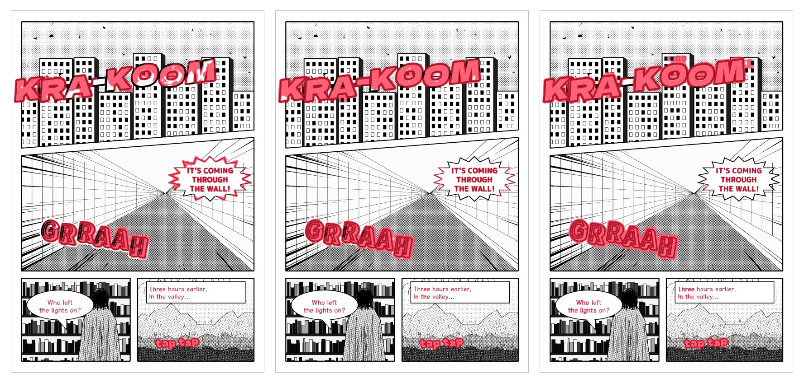

<div align="center">

# Manga Text Mask

**Find the text and sound effects on a manga page, and get them back as a mask.**

Three models, Shin1, Shin2 and Shin3, and one script. Runs locally. No account, no upload.

[Quick start](#quick-start) · [Which model](#which-model) · [Examples](#examples) · [Speed](#speed-and-memory) · [Quality and limits](#quality-and-limits) · [Guide](docs/GUIDE.md)

<br>


</div>

<br>

The mask is built for cleaning: feed it to an inpainting tool to paint over the letters. It marks speech balloons, narration boxes, and sound effects drawn over the art, in Latin and Japanese script.

- **Same size as your page.** Any resolution goes in, and the mask comes back at that resolution.
- **Split into regions.** Each word or effect gets an id in manga reading order, a box, an area and a score.
- **Black and white first.** That is what the models are tuned for. Colour pages work less well.
- **Small.** ResNet-18 U-Nets of 29 to 59 MB that need only ONNX Runtime, on GPU or CPU.

These are checkpoints and they make mistakes, including on art. Read [Quality and limits](#quality-and-limits) before you run one on a batch you cannot check.

## Quick start

```bash
git clone https://github.com/ChoqueCastroLD/manga-text-mask-model
cd manga-text-mask-model
python -m venv .venv
source .venv/bin/activate          # Windows: .venv\Scripts\activate
pip install -r requirements.txt
python manga_text_mask.py examples/sample_page.png -o out --grow 2 --overlay --json --model shin3
```

This installs the CPU version. [The guide](docs/GUIDE.md#install) lists the GPU packages for Windows, Linux and Mac.

Shin1 and Shin2 come with the repository. Shin3 is 29 MB and lives in a [release](https://github.com/ChoqueCastroLD/manga-text-mask-model/releases/tag/shin3). The script downloads it to `model/` the first time you ask for it and checks the file's SHA-256 before keeping it.

From Python:

```python
from manga_text_mask import MangaTextMask, read_page

model = MangaTextMask("shin3")
mask, labels, regions = model.detect(read_page("page.png"), grow=2)

# mask     True on text and sound effects
# labels   the region id of each pixel, 0 where there is none
# regions  [{"id": 1, "box": [x0, y0, x1, y1], "area": 3913, "score": 0.93}, ...]
```

To remove the text from a page, there is a [complete example](examples/clean_page.py):

```bash
python examples/clean_page.py page.png clean.png --model shin3
```

## Which model

| | Shin1 | Shin2 | Shin3 |
|---|---|---|---|
| How to use it | The default | `--model shin2` | `--model shin3` |
| Better at | The first release | Leaving art alone | Finding the most text, and covering giant effects |
| Text found in the tests | 93.5 % | 92.6 % | 95.6 % |
| Giant effect coverage in the tests | 53 % and 27 % | 41 % and 20 % | 98 % and 94 % |
| False detections on the 44 test pages | 125 | 48 | 69 |
| Time on a 2132 × 3200 page, GPU / CPU | 0.35 s / 5.3 s | 0.28 s / 3.2 s | 0.69 s / 8.8 s |
| File size | 59 MB | 29 MB | 29 MB |

- **Shin3 is the one to start with.** It finds the most text and covers nearly all of each giant effect. It also makes fewer false detections than Shin1.
- **Shin2 makes the fewest false detections.** Choose it when a mark on the art costs you more than a letter left behind.
- **Shin1 stays the default** so that older commands keep working.

None of the three replaces a look at the result.

```bash
python manga_text_mask.py page.png -o out --grow 2 --overlay --model shin3
```

The three are the same network with different weights. Shin2 and Shin3 are stored in half precision, and each carries its own settings, which the script applies by itself:

- **Shin2** is stricter. A mark needs a pixel at 0.99 instead of 0.8, and pages at least 1200 px wide run at no more than 2000 px tall.
- **Shin3** runs in giant mode, which takes about twice as long. Each page also runs at half size, and that pass is added only around very large letters. Then the white body of a giant letter is filled when its outline was traced. [The guide](docs/GUIDE.md#using-the-onnx-file-directly) has the details.

The old names still work: `--precise` is Shin2. The files are `model/shin1.onnx` and `model/shin2.onnx`, and `model/shin3.onnx` after the download.

## Examples

From left to right: the page, the Shin3 mask painted over it in red, and the mask.


Both giant effects on the first page are covered whole, including the white inside of the letters. Look closely and you will still see errors:

- On the first page, a few windows above the "OO" are marked.
- On the second page, there are spots on the moon and lit windows in the skyline.

The three models on the same page, from left to right Shin1, Shin2 and Shin3:



Cleaned with `examples/clean_page.py --model shin3`. OpenCV's basic inpainting is fine on balloons and smears badly where a giant effect sits on art, so use a better inpainting model there. One of the dots after "valley" was missed and stays on the page.


### A known failure, and what changed

Shin1, on the left, on flat, geometric art. It takes large white shapes with a clean outline for giant letters, and it marks parts of the flat scenery. On the right is Shin3 on the same page. It leaves almost all of the art alone, with one small mark left on the robot's shoulder.


> **About these pictures.** All three pages are drawn by a script with invented text. They are not real manga and they are not a benchmark. The robot page comes from a first draft. The art of the other two pages was then redrawn with tone and hatching, closer to how manga looks, and Shin1 did much better on them. So they show what the models can do, not how often they do it. For that, see the numbers below.

## Speed and memory

Measured on one desktop with an RTX 3060 Ti (8 GB), with ONNX Runtime 1.24. Times are the median per page, after the first page.

| Page size | Shin1, GPU | Shin1, CPU | Shin2, GPU | Shin2, CPU | Shin3, GPU | Shin3, CPU |
|---|---:|---:|---:|---:|---:|---:|
| 800 × 1232 | 0.10 s | 1.6 s | 0.08 s | 1.5 s | 0.18 s | 2.1 s |
| 1080 × 1080 | 0.16 s | 2.5 s | 0.15 s | 2.3 s | 0.29 s | 3.7 s |
| 1725 × 2475 | 0.29 s | 6.0 s | 0.24 s | 2.9 s | 0.53 s | 6.3 s |
| 2132 × 3200 | 0.35 s | 5.3 s | 0.28 s | 3.2 s | 0.69 s | 8.8 s |

The GPU backend is DirectML. Splitting the mask into regions adds 0.02 to 0.13 s per page. With Shin3, splitting into regions and filling the letter bodies adds 0.03 to 0.26 s.

| Peak memory | Shin1, GPU | Shin1, CPU | Shin2, GPU | Shin2, CPU | Shin3, GPU | Shin3, CPU |
|---|---:|---:|---:|---:|---:|---:|
| System RAM | 0.7 GB | 7.3 GB | 0.6 GB | 4.1 GB | 0.8 GB | 5.2 GB |
| GPU memory | 5.4 GB | none | 2.4 GB | none | 3.9 GB | none |

Memory grows with each new page size the model sees, and only these four sizes were measured. A batch with many different sizes can use more, and `--tile 1536` keeps it bounded.

Only DirectML on Windows and the CPU on Windows have been tested. CUDA and CoreML should work through ONNX Runtime, but have not been tried.

## Quality and limits

Measured on real manga pages, through the script itself.

| Test | Shin1 | Shin2 | Shin3 |
|---|---:|---:|---:|
| Text boxes with at least half their text found, of 299 | 291 | 288 | 293 |
| Share of reviewed text pixels found | 93.5 % | 92.6 % | 95.6 % |
| Share of marked pixels that are text | 91.9 % | 95.5 % | 91.6 % |
| Pages with no false detection, of 44 | 20 | 29 | 25 |
| False detections on those 44 pages | 125 | 48 | 69 |
| Text-free panels left untouched, of 29 | 21 | 23 | 25 |
| Image marked on those panels, on average | 0.13 % | 0.07 % | 0.16 % |
| Text-free covers left untouched, of 36 | 17 | 22 | 26 |
| Image marked on those covers, on average | 0.29 % | 0.23 % | 0.23 % |
| Letter area covered, two giant outlined effects | 53 % and 27 % | 41 % and 20 % | 98 % and 94 % |
| Marked outside those letters | 1.0 % and 1.5 % | 1.0 % and 0.2 % | 1.0 % and 0.7 % |

Shin3 leaves more of the text-free images untouched than the other two. Where it does mark one, the marks are larger, so its average is a little higher.

Treat these as rough figures:

- The 44 pages and the text-free images were also used to choose between model versions and settings, so they flatter all three models, and Shin2 and Shin3 most of all. No untouched test set is left for them.
- The labels of the 44 pages miss some real sound effects, so some false detections are not real errors.
- The text-free images were not used in training. They ran with `--tile 1536`, in greyscale. Specks are not counted when deciding that an image was left untouched.

Two more checks compare the newer models with Shin1. Both use pages not used for training, reviewed by eye.

Shin2:

- On the first set, which also helped to choose the model, it removed 14 of 25 marks on art and 2 of 156 marks on text.
- On colour pages, checked after the model and its settings were fixed, only the low-confidence marks were reviewed. It removed 29 of 55 on art and also 10 of 77 on text. None of the 236 high-confidence marks was lost.

Shin3, on one set of black and white and colour pages:

- It added 109 marked areas. Most of them were real text and effects that Shin1 had missed, including trailing dots.
- It removed 99. Most of them were marks on art.
- It also lost some text: bits of small credits on colour pages, parts of a few hand-lettered words, and one word at the end of a caption.
- One picture of a train got new marks in its regular pattern.

What they get wrong:

- **Shin1 and Shin2 only partly fill giant white letters.** Both often find the outline and part of the body, and Shin2 covers less, as the table above shows. Shin3 fills them, but check giant effects by eye with any model.
- **Black letters with no outline can be missed.** One such giant effect in the tests got 0 % coverage with Shin1 and 7 % with Shin3.
- **They do touch art.** The usual victims are solid black areas, regular hatching and bars, and flat shapes with a clean outline. Shin3 can also mark the line or the grey fill of a burst or cloud balloon drawn over art. Do not run any of them unattended where a damaged panel matters.
- **Colour is secondary.** Expect worse results than on black and white.

## Files

| Path | What it is |
|---|---|
| `model/shin1.onnx` | Shin1, the default |
| `model/shin2.onnx` | Shin2, the fewest false detections |
| `model/shin3.onnx` | Shin3, downloaded on first use from the [release](https://github.com/ChoqueCastroLD/manga-text-mask-model/releases/tag/shin3) |
| `manga_text_mask.py` | Command line tool and Python library |
| `examples/clean_page.py` | Removes the text from a page |
| `examples/sample_page.png` | A drawn page to try it on |
| `docs/GUIDE.md` | Install, options, output formats, troubleshooting |

## License

[Apache-2.0](LICENSE)
